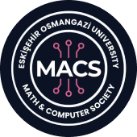

# MACS Kulübü Web Sitesi

<div align="center">



**Eskişehir Osmangazi Üniversitesi**  
**Matematik ve Bilgisayar Bilimleri Topluluğu**

[](https://macsclub.com.tr)
[](https://reactjs.org/)
[](https://fastapi.tiangolo.com/)
[](https://www.postgresql.org/)

</div>

---

## 📋 Proje Hakkında

MACS Kulübü Web Sitesi, Eskişehir Osmangazi Üniversitesi Matematik ve Bilgisayar Bilimleri Bölümü öğrencilerinin oluşturduğu topluluğun resmi web platformudur. Bu platform ile kulüp etkinlikleri, projeler ve ekip tanıtımı yapılmakta ve admin paneli üzerinden içerik yönetimi sağlanmaktadır.

### ✨ Özellikler

- 🎯 **Etkinlik Yönetimi**: Geçmiş ve gelecek etkinliklerin görüntülenmesi ve yönetimi
- 🚀 **Proje Vitrini**: Kulübün geliştirdiği projelerin sergilenmesi
- 👥 **Ekip Tanıtımı**: Yönetim kurulu üyelerinin profilleri
- 🔐 **Admin Panel**: İçerik yönetimi ve kullanıcı yönetimi
- 📱 **Responsive Tasarım**: Mobil, tablet ve desktop uyumlu
- 🎨 **Modern UI/UX**: Framer Motion animasyonları ile zenginleştirilmiş kullanıcı deneyimi
- 🔒 **Güvenli**: JWT authentication, bcrypt şifreleme, rate limiting

---

## 🏗️ Teknoloji Stack

### Frontend
- **Framework**: React 18.3.1
- **Routing**: React Router DOM 6.30.1
- **Animasyon**: Framer Motion 12.23.12
- **İkonlar**: Lucide React 0.544.0
- **Styling**: Custom CSS + CSS Modules
- **Build**: Create React App
- **Deploy**: Vercel

### Backend
- **Yeni API (`backend-ts`)**: Bun `1.3.5`, Hono (`@hono/zod-openapi`), Zod, Drizzle ORM, `postgres`, Pino — [backend-ts/README.md](backend-ts/README.md)
- **Mevcut / Geçiş Dönemi API (`backend`)**: FastAPI 0.110.0, SQLAlchemy 2.0, Alembic (cutover tamamlanana kadar paralel; bkz. [docs/backend-ts-cutover.md](docs/backend-ts-cutover.md))
- **Database**: PostgreSQL 13+ (Docker Compose)
- **Auth & Security**: JWT (`jose`), Bcrypt, IP/route rate limiting, güvenlik başlıkları
- **Deploy**: VPS üzerinde Docker Compose + Plesk nginx ([docs/VPS_DEPLOYMENT.md](docs/VPS_DEPLOYMENT.md), [docs/backend-ts-cutover.md](docs/backend-ts-cutover.md))

---

## 🚀 Hızlı Başlangıç

### Gereksinimler
- Node.js 18+
- Python 3.11+
- PostgreSQL 14+

### Backend Kurulumu

```bash
# Backend dizinine git
cd backend

# Virtual environment oluştur ve aktifleştir
python -m venv venv
source venv/bin/activate  # macOS/Linux
# veya
venv\Scripts\activate  # Windows

# Bağımlılıkları yükle
pip install -r requirements.txt

# .env dosyası oluştur
cp .env.example .env

# Database migration'larını çalıştır
alembic upgrade head

# Sunucuyu başlat
uvicorn main:app --reload
```

Backend `http://localhost:8000` adresinde çalışacaktır.  
API Dokümantasyonu: `http://localhost:8000/docs`

### Frontend Kurulumu

```bash
# Frontend dizinine git
cd frontend

# Bağımlılıkları yükle
npm install

# .env dosyası oluştur
cp .env.example .env

# Development sunucusunu başlat
npm start
```

Frontend `http://localhost:3000` adresinde çalışacaktır.

---

## 📁 Proje Yapısı

```
macs-website/
├── frontend/               # React Frontend
│   ├── public/            # Statik dosyalar
│   ├── src/
│   │   ├── api/           # API client
│   │   ├── components/    # React bileşenleri
│   │   ├── pages/         # Sayfa bileşenleri
│   │   ├── styles/        # CSS dosyaları
│   │   └── utils/         # Yardımcı fonksiyonlar
│   └── package.json
│
├── backend-ts/            # TypeScript/Bun Backend (bkz. backend-ts/README.md)
│   ├── src/              # Hono + Zod + Drizzle modülleri ve güvenlik katmanı
│   ├── drizzle/          # SQL migration dosyaları
│   ├── scripts/          # Yönetici CLI araçları
│   └── contract/         # FastAPI <-> backend-ts parite ve shadow-diff araçları
│
├── backend/               # Eski FastAPI Backend (geçiş süresince paralel)
│   ├── alembic/          # Database migrations
│   ├── models/           # SQLAlchemy modelleri
│   ├── routers/          # API endpoints
│   ├── schemas/          # Pydantic schemas
│   ├── static/           # Statik dosyalar
│   ├── main.py           # FastAPI app
│   └── requirements.txt
│
└── docs/                 # Dokümantasyon
    ├── backend-ts-cutover.md  # Canlı backend-ts geçiş runbook'u
    ├── VPS_DEPLOYMENT.md      # VPS Docker + Plesk kurulumu
    ├── docker.md              # Docker Compose rehberi
    ├── DOCUMENTATION.md       # Detaylı teknik dokümantasyon
    ├── prd.md                 # Product Requirements Document
    └── api-contract.md        # API Contract
```

---

## 📱 Sayfa Yapısı

### Genel Sayfalar
- **Ana Sayfa (/)**: Hero, etkinlikler önizleme, projeler önizleme, hakkımızda, ekip tanıtımı
- **Etkinlikler (/etkinlikler)**: Tüm etkinliklerin listelendiği sayfa, kategori filtreleme
- **Etkinlik Detay (/etkinlikler/:slug)**: Etkinlik detay sayfası
- **Projeler (/projeler)**: Tüm projelerin listelendiği sayfa, kategori filtreleme
- **Proje Detay (/projeler/:slug)**: Proje detay sayfası

### Admin Panel (/admin)
- **Dashboard**: İstatistikler ve hızlı erişim
- **İçerik Yönetimi**: Etkinlik ve proje ekleme/düzenleme
- **Kullanıcı Yönetimi**: Kullanıcı listesi ve moderatör yönetimi
- **Loglar**: Sistem logları (yakında)

---

## 🔐 Authentication

### Giriş Yapma
```bash
POST /auth/login
{
  "username": "user@example.com",
  "password": "password123"
}
```

### Güvenlik Özellikleri
- JWT token based authentication
- Bcrypt ile şifre hashleme
- Rate limiting (5 başarısız deneme sonrası 15 dk kilit)
- Role-based access control (Admin/Moderator)

---

## 🗄️ Veritabanı

### Modeller
- **User**: Kullanıcı bilgileri ve yetkileri
- **Event**: Etkinlik bilgileri
- **EventCategory**: Etkinlik kategorileri
- **Project**: Proje bilgileri
- **ProjectCategory**: Proje kategorileri

Detaylı şema için [DOCUMENTATION.md](docs/DOCUMENTATION.md) dosyasına bakınız.

---

## 🌐 Deployment

VPS üzerinde Docker Compose + Plesk nginx ile yayınlanır:
- Docker Compose yerel/sunucu kurulumu: [docs/docker.md](docs/docker.md)
- Temel VPS + Plesk kurulumu: [docs/VPS_DEPLOYMENT.md](docs/VPS_DEPLOYMENT.md)
- `backend-ts` cutover, shadow-diff, nginx geçişi ve rollback runbook'u: [docs/backend-ts-cutover.md](docs/backend-ts-cutover.md)

---

## 🧪 Testing

### Backend (`backend-ts`)
```bash
cd backend-ts
bun run verify:static
```

### Eski Backend (`backend`)
```bash
cd backend
pytest
```

### Frontend
```bash
cd frontend
npm test
```

---

## 📚 API Dokümantasyonu

API endpoint'lerinin detaylı dokümantasyonu için:
- Development: `http://localhost:8000/docs` (veya `backend-ts` Docker portu `http://127.0.0.1:8010/docs` — `NODE_ENV != production` veya `DOCS_ENABLED=true` iken)
- Prod ortamında (`NODE_ENV=production`) `/docs` varsayılan olarak kapalıdır (`DOCS_ENABLED=true` ile açılabilir).

Ayrıca [docs/DOCUMENTATION.md](docs/DOCUMENTATION.md) ve [backend-ts/README.md](backend-ts/README.md) dosyalarına bakınız.

---

## 🤝 Katkıda Bulunma

Katkıda bulunmak için lütfen [CONTRIBUTING.md](CONTRIBUTING.md) dosyasını okuyun.

### Geliştirme Süreci
1. Developer branch'inden yeni bir feature branch oluşturun
2. Değişikliklerinizi yapın ve test edin
3. Commit mesajlarınızı [Conventional Commits](https://www.conventionalcommits.org/) formatında yazın
4. Pull Request açın (hedef: `developer` branch)

---

## 👥 Ekip

**Proje Koordinatörü:** Doğu Alagöz  
**Kulüp Başkanı:** Berke Zerelgil

### Yönetim Kurulu
- Efe Altın - Başkan Yardımcısı
- Yiğit Yücel - Genel Koordinatör
- Kerem Alagöz - Proje Koordinatörü
- Hira Yılmaz - Denetim Koordinatörü
- Eren Alpaslan - Denetim Koordinatörü
- Leyla Mammadova - Kurumsal İletişim Koordinatörü
- Azra Üsküp - Genel Sekreter
- Ali Erdem Geçgel - Halkla İlişkiler
- Ahsen Aslan - Tasarım ve Sosyal Medya Koordinatörü
- Çağrı Arı - Tasarım ve Sosyal Medya Koordinatörü

---

## 🐛 Sorun Bildirme

Bir sorun bulduysanız veya öneriniz varsa lütfen [GitHub Issues](https://github.com/macs-club/website/issues) üzerinden bildirin.

---

## 📞 İletişim

- **Website**: [macsclub.com.tr](https://macsclub.com.tr)
- **Email**: info@macsclub.com.tr
- **Instagram**: [@macs_esogu](https://instagram.com/macs_esogu)

---

## 📄 Lisans

Bu proje MACS Kulübü tarafından geliştirilmiştir. Tüm hakları saklıdır.

---

## 📝 Changelog

### v1.0.0 (Kasım 2024)
- ✅ İlk production release
- ✅ Etkinlik ve proje yönetim sistemi
- ✅ Admin panel (dashboard, içerik yönetimi, kullanıcı yönetimi)
- ✅ JWT authentication ve güvenlik özellikleri
- ✅ Responsive tasarım ve modern UI
- ✅ Vercel ve Railway deployment

---

<div align="center">

**Made with ❤️ by MACS Club**

[Website](https://macsclub.com.tr) • [Instagram](https://instagram.com/macs_esogu) • [GitHub](https://github.com/macs-club)

</div>

